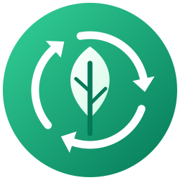
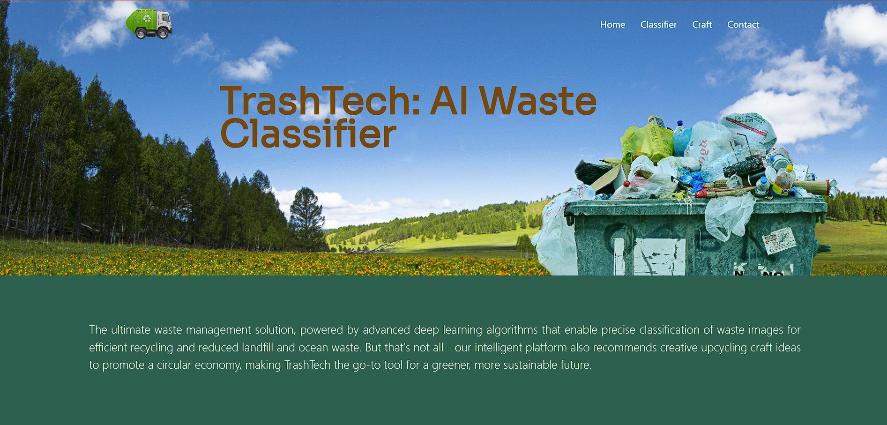
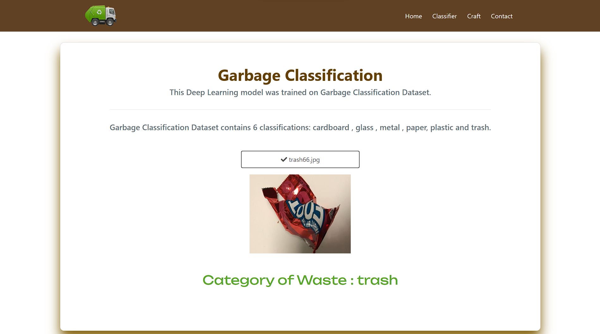
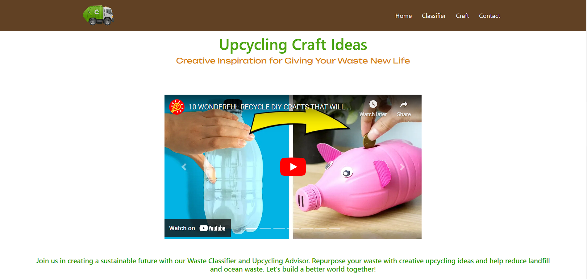
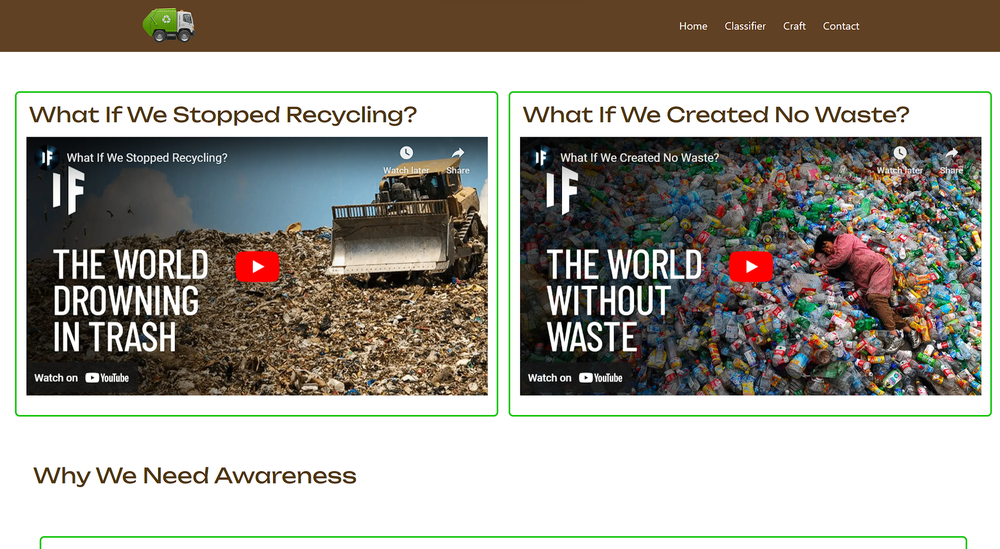

<p align="center">
  
</p>

<h1 align="center">WasteWise</h1>

<p align="center">
  An AI-powered waste classification application that turns images into actionable recycling insights.
</p>

<p align="center">
  
  
  
</p>

## About

WasteWise uses deep learning and computer vision to identify seven types of waste from a photo and encourages responsible disposal, recycling and creative reuse. It is built with Flask and a VGG16-based Keras model trained on more than 5,000 images of waste items.



## Features

- **Image-based classification:** upload a photo and get the predicted waste category.
- **Seven waste categories:** plastic, glass, metal, paper, cardboard, organic and miscellaneous.
- **Craft and reuse ideas:** creative upcycling suggestions that give waste a second life.
- **Recycling awareness:** explains what happens to resources, ecosystems and the climate when waste is not recycled.
- **Responsive web interface:** a home page, a classification page and a footer with contact details.



## How it works

1. The user uploads an image on the classification page.
2. Flask saves it to `uploads/` and resizes it to 224×224.
3. The VGG16-based model (`vgg16-0014.hdf5`) predicts the waste category.
4. The result is shown in the browser alongside reuse and recycling guidance.

The model was trained in [`Garbage_and_waste_material_Classification.ipynb`](Garbage_and_waste_material_Classification.ipynb).



## Tech stack

| Area | Tools |
| --- | --- |
| Backend | Python, Flask, Werkzeug, Gevent, Gunicorn |
| Machine learning | TensorFlow, Keras (VGG16), NumPy, Pillow |
| Frontend | HTML, CSS, JavaScript, Bootstrap |

## Getting started

```bash
git clone <repository-url>
cd WasteWise
pip install -r requirements.txt
python app.py
```

Then open <http://localhost:5000> in your browser.

## Usage

1. Open the app and go to the classification section.
2. Upload an image of a waste item.
3. Read the predicted category.
4. Browse the craft and reuse sections for ideas.



## Project structure

```
WasteWise/
├── app.py                # Flask app and prediction endpoint
├── vgg16-0014.hdf5       # Trained model
├── requirements.txt
├── templates/            # HTML templates
├── static/               # CSS, JS and images
├── uploads/              # Uploaded images
└── Garbage_and_waste_material_Classification.ipynb
```

## Contributing

Bug reports and suggestions are welcome. Open an issue or email [padmaiyer01@protonmail.com](mailto:padmaiyer01@protonmail.com).

## Author

**Padma Iyer** — [padmaiyer01@protonmail.com](mailto:padmaiyer01@protonmail.com)
